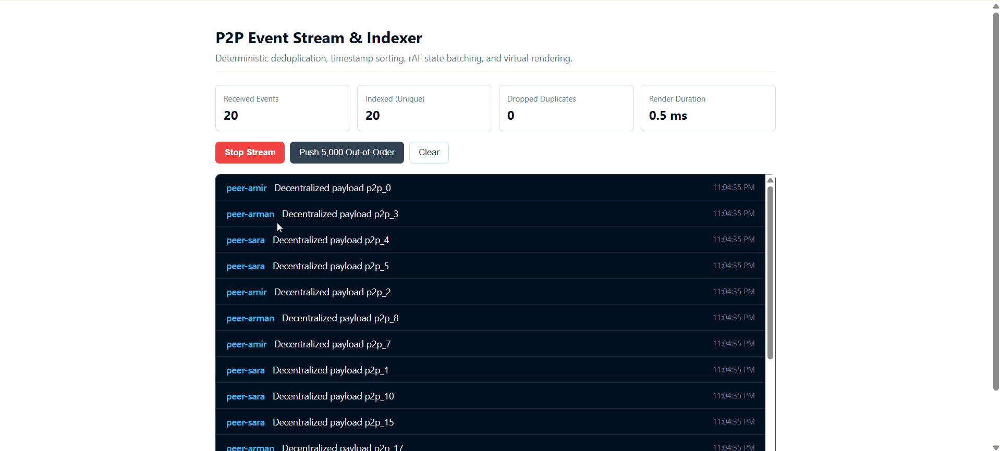

# Peer Message List

A high-performance, real-time event indexing and rendering engine designed for peer-to-peer (P2P) desktop applications.

Peer Message List explores scalable frontend architecture for handling high-volume, out-of-order event streams. It focuses on deterministic message ordering, efficient deduplication, batched state updates, and windowed virtualization to maintain responsive UI performance under heavy workloads.

Built as an architectural exploration for decentralized collaboration platforms and desktop environments such as Holepunch, Pear Runtime, and Keet.

---

## Simulation Demo

The following simulation demonstrates the message processing pipeline under concurrent, out-of-order packet delivery.

It showcases:

- Real-time message ingestion and indexing.
- Duplicate packet detection and rejection.
- Deterministic chronological ordering.
- Batched state updates using `requestAnimationFrame`.
- Virtualized rendering with a bounded DOM footprint.
- Live processing statistics and UI performance monitoring.

<p align="center">
  
</p>

---

## Architecture Overview

In distributed P2P environments, messages can arrive out of order due to unpredictable network latency, clock differences, and intermittent connectivity.

Updating the entire UI for every incoming packet can introduce unnecessary rendering overhead and negatively affect responsiveness.

Peer Message List addresses this challenge by separating message ingestion, indexing, state management, and rendering into independent layers.

### Data Flow

```text
[ P2P Transport / WebSocket / Simulated Stream ]
                       |
                       v
              [ Ingestion Queue ]
                       |
                       v
          [ Scheduled Batch Processing ]
              requestAnimationFrame
                       |
                       v
                [ Message Index ]
           Deduplication & Binary Search
                       |
                       v
                [ Zustand Store ]
             Immutable State Snapshots
                       |
                       v
              [ Virtualized Viewport ]
             Visible Rows + Overscan
```

Each layer has a specific responsibility, allowing the transport, indexing logic, and rendering system to evolve independently.

---

## Core Technical Highlights

### 1. Deterministic Message Indexing & Deduplication

`src/core/messageIndex.ts`

- **O(1) Duplicate Detection:** Uses an in-memory `Set<string>` to identify previously processed message IDs before modifying the indexed collection.
- **Chronological Ordering:** Uses binary search to determine the correct insertion position based on event timestamps (`ts`).
- **Arrival-Order Independence:** Maintains timestamp-based ordering regardless of packet arrival sequence.
- **Constant-Time Telemetry:** Tracks received packets, unique indexed messages, and rejected duplicates without repeatedly traversing the entire collection.

### 2. Batched State Management with requestAnimationFrame

`src/store/messageStore.ts`

- **Buffered Ingestion:** Incoming messages are temporarily stored in a non-reactive queue to avoid triggering unnecessary state updates.
- **Frame-Synchronized Updates:** Batches queued messages and flushes state updates through `requestAnimationFrame`.
- **Immutable State Snapshots:** Creates updated array references using `items.slice()` to ensure compatibility with React's reference-based change detection.
- **Reduced Rendering Overhead:** Groups multiple incoming events into fewer state updates instead of updating the UI for every packet.

### 3. Windowed List Virtualization

`src/components/VirtualizedList.tsx`

- **Custom Virtualization Engine:** Calculates visible list boundaries dynamically using the current scroll position.
- **Bounded DOM Rendering:** Renders only visible rows and a configurable overscan buffer.
- **Scalable Rendering:** Avoids creating DOM elements for every indexed message, even when processing large datasets.
- **Consistent UI Responsiveness:** Keeps the rendered DOM footprint proportional to the viewport rather than the total message count.

### 4. Decoupled Transport Abstraction

`src/core/transport.ts`

- **Transport Interface:** Defines a common interface for different message delivery mechanisms.
- **Flexible Integration:** Supports simulated message sources and provides an integration point for WebSocket or P2P transport implementations.
- **Separation of Concerns:** Keeps network delivery logic independent from message indexing and UI state management.

---

## Performance Benchmark

The following measurements represent the project's simulation and rendering tests.

| Scenario                    |         Ingestion Volume | Indexed Unique | Duplicate Rejection | Avg. Render Time | UI Responsiveness |
| --------------------------- | -----------------------: | -------------: | ------------------: | ---------------: | ----------------- |
| Burst Stress Test           | 5,000 out-of-order items |          5,000 |                   0 |      ~0.5–1.2 ms | 60 FPS target     |
| Simulated Continuous Stream |          ~40 packets/sec |        Dynamic |                 ~5% |          ~0.4 ms | Smooth scrolling  |

**Benchmark notes:**

- Rendering measurements refer to observed React Profiler render durations, not total packet processing latency.
- The continuous stream uses simulated packet delivery.
- Results depend on hardware, browser environment, dataset characteristics, and test conditions.
- The 60 FPS figure represents the rendering target rather than a guarantee across all devices.

---

## Project Structure

```text
peer-message-list/
├── docs/
│   └── demos/
│       └── simulation.gif
│
├── .github/
│   └── workflows/
│       └── ci.yml
│
├── src/
│   ├── components/
│   │   └── VirtualizedList.tsx
│   │
│   ├── core/
│   │   ├── messageIndex.ts
│   │   ├── messageIndex.test.ts
│   │   └── transport.ts
│   │
│   ├── store/
│   │   ├── messageStore.ts
│   │   ├── messageStore.test.ts
│   │   └── useMessages.ts
│   │
│   ├── App.tsx
│   └── main.tsx
│
├── package.json
├── tsconfig.json
└── vite.config.ts
```

---

## Getting Started

### Prerequisites

- Node.js >= 20.x
- npm >= 10.x

### Installation

Clone the repository and install dependencies:

```bash
git clone https://github.com/a-pourhasan/peer-message-list.git
cd peer-message-list
npm install
```

### Development

Start the Vite development server:

```bash
npm run dev
```

### Testing

Run the unit and integration tests:

```bash
npm test
```

### Production Build

Run the production build and TypeScript checks:

```bash
npm run build
```

---

## Tech Stack

- **React** — Component-based UI architecture.
- **TypeScript** — Type-safe application logic.
- **Zustand** — Lightweight state management.
- **Vite** — Development server and production bundling.
- **Vitest** — Unit and integration testing.
- **requestAnimationFrame** — Frame-synchronized state batching.

---

## License

This project is licensed under the MIT License.
